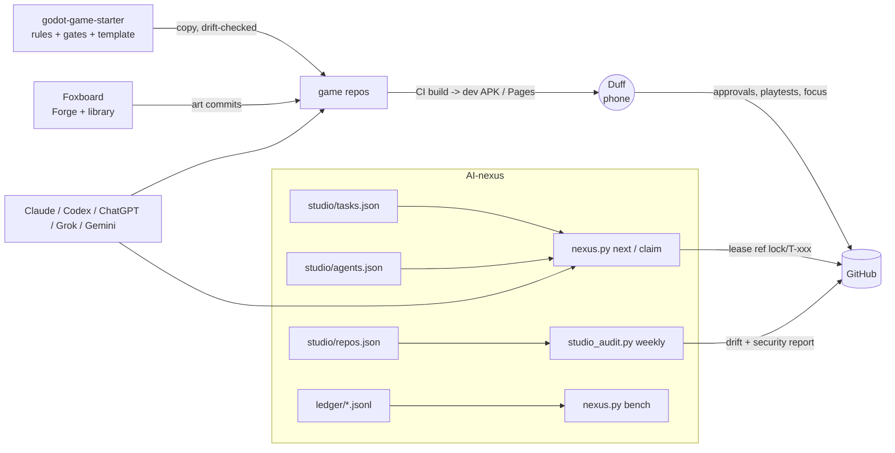

# Studio architecture map (2026-11-26)

Machine-readable version: `studio/repos.json` (`python3 tools/nexus.py deps <repo>`).

## Layers

| Layer | Repo | Owns | Talks to |
|---|---|---|---|
| Orchestration | **AI-nexus** | studio task queue, task leases, agent registry, usage + outcome ledgers, weekly studio audit, PROTOCOL.md | reads every public repo (audit); agents read/write it |
| Standards | **godot-game-starter** | master AGENTS.md + `standards/`, guard.py + pre-push, rule lock, fresh-eyes gate, build/test/autoplay, Eyes, keystone, web export | copied into each game repo |
| Creative | **Foxboard** | art library, style bible, Forge renders (free Actions runners), outbox sweep, marketing assets | pushes art into game repos (`grok_art/`, inbox + `foxboard_decode.yml`) |
| Memory + collaboration | **GitHub** | history, branches, PRs, reviews, labels (`duff-ok`), Actions, Releases (`dev` APK), Pages | everything |
| Products | games: Rush (focus), chaos, duffquest, lethemoor, hunter, pocket-fight; site: 3-eyed-fox | game code, per-game QUEUE.md + handoff | inherit standards, receive art |
| Private | market repo | its own rules; never feeds public repos | none (isolated) |

## Flow

Plain-text version (for the GitHub app if Mermaid doesn't render):
1. An AI asks AI-nexus for the next task it can do (`next`), takes the lease (`claim`), and works in the target repo.
2. The target repo's own rules and gates apply there (from godot-game-starter): tests, push guard, fresh-eyes, rule lock.
3. Art comes from Foxboard into the game repos; nobody hand-copies art.
4. CI builds the APK / web build; Duff installs and plays from his phone.
5. The AI records the outcome + usage in AI-nexus, writes the handoff in the repo, releases the lease.
6. Weekly, AI-nexus audits every public repo for rule drift, missing gates and security findings.

## Dependency edges

| Repo | Depends on | Kind |
|---|---|---|
| every game repo | godot-game-starter | rules + template code (copied) |
| chaos, duffquest, lethemoor, hunter, Rush | Foxboard | art |
| Foxboard | godot-game-starter | rule_lock.py, fresh_eyes.yml |
| 3-eyed-fox | Foxboard | brand |
| AI-nexus, godot-game-starter, market repo | none | |

A change to godot-game-starter's rules is a change to every repo that copies them: the weekly audit shows
which copies are behind, and the re-sync PRs go through each repo's rule lock (Duff's `duff-ok`).
